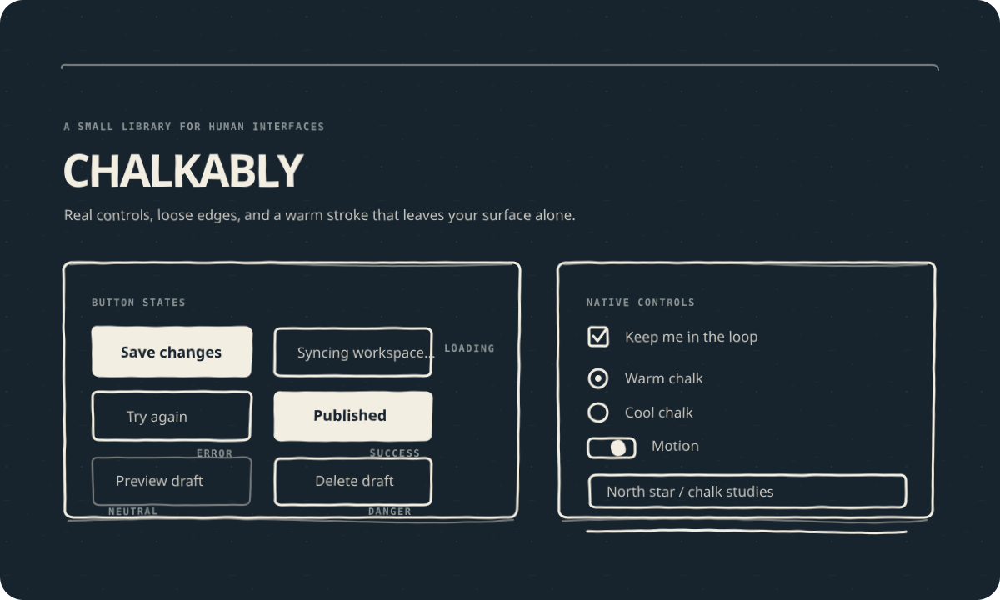
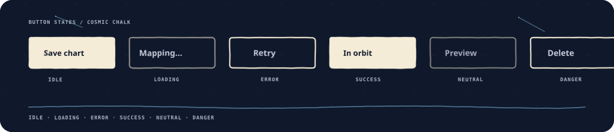

# Chalkably

Chalkably is a tiny UI component library that makes real HTML controls feel
like they were drawn in warm chalk. It adds seeded, lightly animated SVG
chrome while leaving the native element, keyboard behaviour, and accessibility
semantics in place.

The library is surface-agnostic: strokes are transparent over your surface by
default. The example board uses a midnight navy background so moon-white chalk
and cool constellation accents have room to breathe.



## Install

The fork is currently an unpublished pre-release. From a local checkout:

```sh
npm install /path/to/chalkably
```

When the package is published, the package name is `chalkably`:

```sh
npm install chalkably
```

## Vanilla quick start

Import the CSS once, then attach a control to an existing element. The element
stays real HTML; Chalkably adds an `aria-hidden` SVG underneath it.

```js
import { chalkablyButton } from "chalkably";
import "chalkably/style.css";

const save = document.querySelector("#save");
const sketch = chalkablyButton(save, { variant: "solid" });

save.addEventListener("click", async () => {
  sketch.setState("loading");
  await saveDocument();
  sketch.setState("success");
});
```

Every attacher returns a sketch handle:

```js
sketch.resketch();     // a fresh random seed
sketch.resketch(42);   // a reproducible seed
sketch.destroy();      // remove the SVG and listeners
```

## React

React adapters are optional peer-only components. They are client-side
components and pass native element props through to the underlying element.

```jsx
import { ChalkablyButton, ChalkablyCard } from "chalkably/react";
import "chalkably/style.css";

export function SavePanel({ saving }) {
  return (
    <ChalkablyCard>
      <p>Draft changes are ready to share.</p>
      <ChalkablyButton
        variant="solid"
        state={saving ? "loading" : "idle"}
        onClick={saveDocument}
      >
        Save changes
      </ChalkablyButton>
    </ChalkablyCard>
  );
}
```

## Controls

| Vanilla function | React component | Element shape |
| --- | --- | --- |
| `chalkablyButton(el, opts)` | `ChalkablyButton` | a `<button>` |
| `chalkablyCard(el, opts)` | `ChalkablyCard` | any block element |
| `chalkablyCheckbox(wrap, opts)` | `ChalkablyCheckbox` | wrapper containing a checkbox input |
| `chalkablyRadio(wrap, opts)` | `ChalkablyRadio` | wrapper containing a radio input |
| `chalkablyToggle(wrap, opts)` | `ChalkablyToggle` | wrapper containing a checkbox input |
| `chalkablyDivider(el, opts)` | `ChalkablyDivider` | an `<hr>` or div |
| `chalkablyInput(wrap, opts)` | `ChalkablyInput` | wrapper containing an input |

The input remains in the DOM, so labels, forms, focus, keyboard input, and
screen readers continue to work. The SVG is decorative and `aria-hidden`.

### Button states

Buttons support three visual variants:

- `outline` (default), `solid`, and `scribble`
- `idle`, `loading`, `error`, and `success` state values
- `neutral` and `danger` tones for secondary or destructive actions

Use `setState` on a vanilla sketch or pass `state` to a React component. A
loading button dims and boils faster; error and success use the theme colours.



## Options and theming

The optional Cosmic Chalk theme gives the same controls a midnight-board
palette: warm moon chalk, a cool comet focus accent, and restrained
starlight state colors. It is transparent, so your host still owns the
surface:

```js
import "chalkably/style.css";
import "chalkably/themes/cosmic.css";
```

Add `data-chalkably-theme="cosmic"` (or the `chalkably-theme-cosmic` class) to
the host that wraps your controls. The theme export is available at
`chalkably/themes/cosmic.css`.

All seven controls accept these drawing options:

| Option | Default | Purpose |
| --- | --- | --- |
| `seed` | random | repeat a sketch by passing a number |
| `roughness` | `1` | wobble of the base geometry |
| `boil` | `0.3` | frame-to-frame flicker in px; `0` is static |
| `stroke` | theme colour | chalk outline colour |
| `fill` | theme colour | chalk fill colour for solid shapes |
| `paper` | theme colour | text colour on solid shapes |
| `width` | `2` | chalk stroke width in px |

Set CSS custom properties on a board or on one control. The public names all
start with `--chalkably-`:

```css
.chalkboard {
  --chalkably-stroke: #f5f0e6;
  --chalkably-fill: #f5f0e6;
  --chalkably-paper: #17232d;
  --chalkably-error: #ff9a8f;
  --chalkably-success: #91ddb4;
}
```

Cosmic Chalk also exposes these palette tokens for surrounding UI:
`--chalkably-moon`, `--chalkably-comet`, `--chalkably-starlight`,
`--chalkably-neutral`, `--chalkably-error`, `--chalkably-success`, and
`--chalkably-paper`. Its intentional stroke width is `2.25px`.

Chalkably does not add a background, font, or runtime dependency. Your host
surface owns those decisions.

## Motion and accessibility

The sketch gently boils between seeded frames and interactive controls
re-sketch on hover and press. `prefers-reduced-motion: reduce` freezes the
sketch and skips those interaction redraws. Keep the native control and its
label in the document; never replace it with a decorative imitation.

## Custom geometry

The rough geometry exports stay available for custom SVG work:
`roughRoundedRect`, `roughLine`, `roughCircle`, `roughCheckmark`,
`scribbleFill`, `variants`, and the seeded `mulberry32`/`randomSeed` helpers.

```js
import { roughRoundedRect, variants } from "chalkably";

const frames = variants(
  (options) => roughRoundedRect(0, 0, 200, 80, 12, options),
  { seed: 7, roughness: 1, boil: 0.3 },
);
```

## License

MIT. Chalkably preserves Daniel Belyi's original copyright and identifies
subsequent modifications by Hasan Shoaib in the license file.
