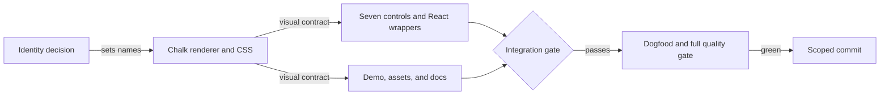

# Chalkably v0.1

Status: in progress  
Owner: Hasan  
Source: `hhushhas/chalkably`, forked from `Danilaa1/drawably`

## Background

Drawably is a small MIT-licensed TypeScript library for seven hand-drawn controls. It uses deterministic SVG paths, three-frame stroke animation, native form controls, and optional React wrappers. The package has no runtime dependencies.

The fork should feel drawn with chalk instead of ink. The desired state is a faithful chalk translation: the same small API, controls, accessibility, deterministic seeds, and motion rules, with a new visual character and clear project identity. It should still feel like one idea, not the start of a general design system.

## Done

The first release is done when:

- All seven existing controls work in vanilla JavaScript and React: button, card, checkbox, radio, toggle, divider, and input.
- A user can identify the visual as chalk at a glance. Strokes have uneven density, soft powder gaps, and small edge variation instead of looking like white pen lines.
- A seed still produces the same geometry and animation frames across redraws.
- Native inputs, keyboard use, labels, focus, form behavior, and `aria-hidden` decorative SVGs remain intact.
- `prefers-reduced-motion` freezes the stroke and stops pointer-triggered redraws.
- The demo shows every control on a dark slate surface, including idle, loading, error, success, neutral, and danger states.
- The README explains installation, vanilla and React use, theming, motion, and the relationship to the original project.
- Build, type-check, tests, and package dry-run pass.
- The original MIT license and attribution remain in the repository and shipped package.

The first release stops before npm publication, a hosted docs site, new controls, an API redesign, framework wrappers beyond React, or a light-surface theme.

## Behavior and language

The product terms are:

- **Chalk stroke:** the visible layered SVG mark.
- **Board:** the dark host surface behind a control.
- **Boil:** the gentle three-frame change between related chalk strokes.
- **Resketch:** a redraw with a new seed.
- **Powder:** sparse gaps and faint secondary marks that make the stroke read as chalk.

Controls keep the current state model. A loading control boils faster, error uses warm red chalk, success uses green chalk, and reduced-motion users see one stable frame. The SVG remains decoration. The real element remains the source of input, focus, and form behavior.

## Visual direction

The default demo uses a deep slate board, warm white chalk, low-contrast board grain, and compact sans-serif type. The controls themselves draw transparent chalk over the host surface. Chalk color comes from CSS custom properties. Geometry stays loose but readable. Texture must not reduce the focus outline or make labels hard to read.

The visual signature comes from deterministic layered strokes, not from a background image or a new runtime dependency. The main line carries the shape. A lighter broken line creates powder gaps. A faint offset line softens the edge. The boil animation swaps complete seeded frames, as Drawably does today.

## System

The public control contract remains the seam. The DOM layer owns element validation, SVG lifecycle, resizing, state, and cleanup. The pure renderer owns seeded geometry. CSS owns palette, layer opacity, state colors, focus, and motion.

The first implementation should preserve the current exported rough-shape functions and `variants` return type. Chalk texture is added without making consumers understand SVG filters or a new render model. Internal class and CSS variable names change only as one complete namespace migration, with compatibility aliases if the chosen package name changes.

Function shapes that must remain stable:

```text
attach control(element, options?) -> SketchHandle
SketchHandle.resketch(seed?) -> void
SketchHandle.setState(state) -> void
SketchHandle.destroy() -> void
rough shape(geometry, RoughOptions) -> SVG path string
variants(generator, RoughOptions, count?) -> SVG path strings
```

## Implementation route

1. Set the final project name, package namespace, repository metadata, and attribution before broad code edits.
2. Add the chalk stroke treatment at the renderer/DOM/CSS seam while preserving deterministic geometry and the current accessibility contract.
3. Apply the treatment to all seven controls and React wrappers without adding components.
4. Rework the demo, SVG assets, README, and agent guide around the chalk vocabulary and chosen package name.
5. Dogfood the demo, fix visible problems, then run build, type-check, tests, and package dry-run.
6. Stage only this fork's files and make one conventional commit. Do not publish or push without a later instruction.



## Anti-slop rules

- Do not add a canvas renderer, animation library, CSS framework, icon package, or runtime dependency.
- Do not hide weak chalk strokes behind a noisy board texture. The stroke itself must carry the effect.
- Do not rename half the namespace. Package exports, TypeScript names, CSS classes, custom properties, docs, tests, and assets must agree.
- Do not replace native inputs with painted controls.
- Do not make boil faster or rougher until labels become tiring to read.
- Do not remove Daniel Belyi's MIT attribution.
- Do not publish to npm, deploy a site, touch production, or push the commit in this phase.
